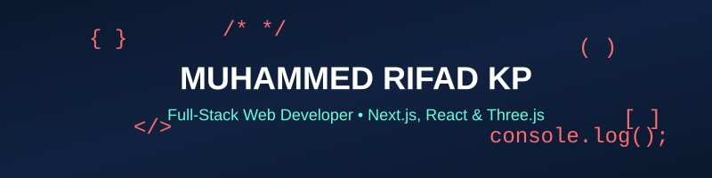
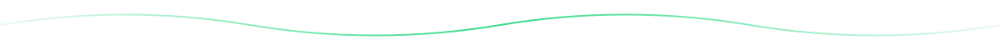
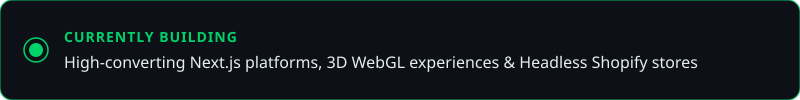
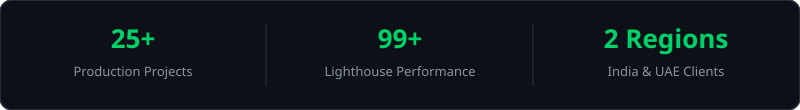
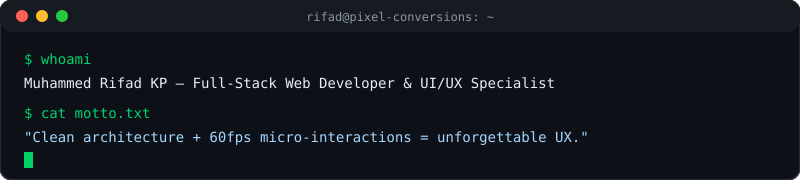
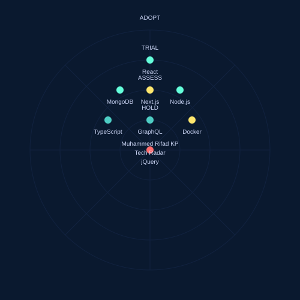

<div align="center">
  
  <br/>
  
</div>

<div align="center">

# 👋 Hi there, I'm [Muhammed Rifad KP](https://www.rifad.site)

### **Full-Stack Web Developer & UI/UX Specialist**
**Crafting High-Performance Web Apps, E-Commerce Platforms & Immersive 3D Experiences**

📍 *Calicut, Kerala, India & Dubai, UAE*

[](https://www.rifad.site)
[](https://linkedin.com/in/muhammed-rifad-64a7172b9)
[](https://wa.me/917356852496)
[](mailto:muhammedrifadkp3@gmail.com)
[](https://www.instagram.com/mohd_rifad_/)
[](https://github.com/muhammedrifadkp)

<br/><br/>

[⚡ About](#-about-me) • [🚀 Services](#-services--capabilities) • [🛠️ Tech Stack](#️-tech-stack--skills) • [⚙️ Architecture](#-architecture--performance-philosophy) • [🌟 Projects](#-featured-client-works--case-studies) • [📊 Analytics](#-github-analytics--activity) • [📬 Connect](#-lets-build-something-exceptional)

</div>

<div align="center">
  
</div>

## ⚡ About Me

<div align="center">
  
  <br/>
  
</div>

<br/>

I am a **Full-Stack Web Developer** and founder at **Pixel Conversions**, delivering bespoke digital experiences that convert visitors into revenue. Based in Kozhikode (Calicut), Kerala, I engineer robust web applications and digital stores for businesses and startups across **India** and the **UAE**.

- 🌐 **Official Portfolio**: **[https://www.rifad.site](https://www.rifad.site)**
- 🚀 **Core Focus**: High-performance **Next.js** applications, **React 19 / Vite**, **Three.js** interactive 3D web graphics, **Tailwind CSS**, and scalable **Node.js** architectures.
- 💼 **Available For**: Freelance contracts, enterprise consulting, custom web platforms, and e-commerce developments.
- 💬 **Ask me about**: Performance optimization, SSR/SSG architectures, WebGL/Three.js shaders, Headless Shopify, and technical SEO.

```javascript
const rifad = {
  name: "Muhammed Rifad KP",
  role: "Full-Stack Web Developer",
  location: "Calicut, Kerala, India",
  portfolio: "https://www.rifad.site",
  services: [
    "Full-Stack Web Applications",
    "Bespoke E-Commerce & Shopify Stores",
    "Interactive 3D / WebGL Experiences",
    "UI/UX Design Systems & Micro-Interactions"
  ],
  stack: {
    frontend: ["Next.js", "React", "Three.js", "TypeScript", "Tailwind CSS"],
    backend: ["Node.js", "Express", "REST APIs", "GraphQL"],
    databases: ["MongoDB", "PostgreSQL", "MySQL", "Redis"],
    devops: ["Docker", "Vercel", "GitHub Actions", "Cloudflare"]
  },
  funFact: "Clean code + 60fps animations = unforgettable user experience."
};
```

<div align="center">
  
</div>

<div align="center">
  
</div>

## 🚀 Services & Capabilities

<table>
  <tr>
    <td width="50%" valign="top">
      <h3>🌐 Full-Stack Web Apps</h3>
      <p>End-to-end <b>Next.js 15</b> &amp; <b>React 19</b> applications with SSR/SSG, clean REST/GraphQL APIs, and scalable cloud deployment.</p>
    </td>
    <td width="50%" valign="top">
      <h3>🛒 E-Commerce &amp; Shopify</h3>
      <p>High-converting <b>Headless Shopify</b> &amp; custom MERN storefronts engineered for speed, SEO, and seamless checkout flows.</p>
    </td>
  </tr>
  <tr>
    <td width="50%" valign="top">
      <h3>🎮 3D &amp; Interactive WebGL</h3>
      <p>Immersive <b>Three.js</b> &amp; <b>React Three Fiber</b> experiences with custom shaders, smooth 60fps GSAP/Framer Motion animations.</p>
    </td>
    <td width="50%" valign="top">
      <h3>🎨 UI/UX Design Systems</h3>
      <p>Pixel-perfect, WCAG-accessible component libraries in <b>Figma</b> &amp; <b>Tailwind CSS</b> with micro-interactions that delight users.</p>
    </td>
  </tr>
</table>

---

## 🛠️ Tech Stack & Skills

<div align="center">
  
</div>

<br/>

| Category | Technologies & Tools |
| :--- | :--- |
| **Frontend Frameworks** | React 19, Next.js 15 (App Router / SSR / SSG), Vite, Vue |
| **Styling & 3D** | Tailwind CSS, Three.js, React Three Fiber (R3F), GSAP, Framer Motion |
| **Backend & APIs** | Node.js, Express, RESTful APIs, JWT Auth, Webhooks |
| **Databases** | MongoDB, Mongoose, PostgreSQL, MySQL, Redis |
| **DevOps & Cloud** | Git, GitHub Actions, Docker, Vercel, Netlify, Cloudflare |
| **Design & UI/UX** | Figma, Adobe Creative Cloud, Responsive Design, WCAG Accessibility |

<div align="center">
  
  <br/><br/>
  
</div>

<div align="center">
  
</div>

## ⚡ Architecture & Performance Philosophy

- **Core Web Vitals First**: Every build targets **99+ Lighthouse** scores with zero layout shift (CLS), optimized LCP, and edge caching.
- **Modular & Type-Safe**: Strict **TypeScript** contracts, reusable design tokens, and clean separation of concerns.
- **Motion with Purpose**: GPU-accelerated **60fps** transitions using Framer Motion, GSAP, and Three.js shaders.
- **SEO & Conversion Ready**: Semantic HTML5, structured JSON-LD metadata, and conversion-focused UX flows.

### 🔄 Engineering Workflow

```
Discover & Wireframe  ──▶  Design System (Figma)  ──▶  Full-Stack Build (Next.js / Node)  ──▶  60fps Polish & Edge Deploy
```

---

## 🌟 Featured Client Works & Case Studies

Each of these production platforms is documented with full metrics, architecture breakdowns, and live deployments on my portfolio:

| Project | Description | Live & Case Study Links | Tech Stack |
| :--- | :--- | :--- | :--- |
| **Pixel Conversions** | High-growth digital agency selling custom Next.js builds, Shopify stores, and paid performance marketing. | [📖 Case Study](https://www.rifad.site/projects/pixel-conversions) • [🌐 Live Site](https://www.pixelconversions.com/) • [💻 GitHub](https://github.com/muhammedrifadkp/pixel-conversions) | Next.js, Tailwind, Shopify |
| **ZHM Real Estate LLC** | Luxury real estate portal for prime Dubai properties, off-plan projects, and instant WhatsApp booking. | [📖 Case Study](https://www.rifad.site/projects/zhm-real-estate) • [🌐 Live Site](https://zhmrealestatellc.com/) | React, Vite, Tailwind CSS |
| **Fixerland Services** | On-demand mobile device repair and parts replacement booking platform with multi-step diagnostics. | [📖 Case Study](https://www.rifad.site/projects/fixerland) • [🌐 Live Site](https://fixerland.com/) | React, Node.js, Express |
| **AG Star Automobiles** | Premium pre-owned and multi-brand automotive showroom catalogue with live vehicle filtering. | [📖 Case Study](https://www.rifad.site/projects/ag-star) • [🌐 Live Site](https://agstarautomobiles.com/) | Next.js, Tailwind, REST API |
| **AD Firms Setup** | Comprehensive UAE corporate services, business setup, and trade licensing platform in Dubai. | [📖 Case Study](https://www.rifad.site/projects/ad-firms) • [🌐 Live Site](https://adfirms.ae/) | React, Vite, Framer Motion |
| **Midhula Farm Hub** | E-commerce storefront and live inventory catalog for exotic fish and aquatic plants in Kerala. | [📖 Case Study](https://www.rifad.site/projects/midhula-farm) • [🌐 Live Site](https://midhulafarmhub.com/) | MERN Stack, Razorpay |
| **CDC Attendance System** | Complete attendance tracking and academic reporting management suite for institutions. | [📖 Case Study](https://www.rifad.site/projects/cdc-attendance) • [💻 GitHub](https://github.com/muhammedrifadkp/CDC_Attendance) | React, Node.js, MongoDB |
| **MERN E-Commerce Store** | Full-featured online store with JWT authentication, cart state, admin inventory, and payments. | [📖 Case Study](https://www.rifad.site/projects/my-ecommerce) • [💻 GitHub](https://github.com/muhammedrifadkp/my-ecommerce) | React, Express, MongoDB, Redux |

👉 **Explore all project breakdowns, tech stacks, and metrics at [https://www.rifad.site/projects](https://www.rifad.site/projects)**

<div align="center">
  
</div>

## 📊 GitHub Analytics & Activity

<div align="center">
  
  <br/>
  
  
  <br/><br/>
  
  <br/><br/>
  
  <br/><br/>
  
</div>

<div align="center">
  
</div>

## 📬 Let's Build Something Exceptional

Whether you're starting a new venture from scratch, scaling an existing product, or want a high-converting web presence:

- 🌐 **Portfolio & Case Studies**: [https://www.rifad.site](https://www.rifad.site)
- 💬 **WhatsApp**: [+91 73568 52496](https://wa.me/917356852496)
- 📧 **Email**: [muhammedrifadkp3@gmail.com](mailto:muhammedrifadkp3@gmail.com)
- 💼 **LinkedIn**: [linkedin.com/in/muhammed-rifad-64a7172b9](https://linkedin.com/in/muhammed-rifad-64a7172b9)
- 📸 **Instagram**: [@mohd_rifad_](https://www.instagram.com/mohd_rifad_/)

<div align="center">
  <a href="https://www.rifad.site"></a>
  <a href="https://wa.me/917356852496"></a>
  <a href="mailto:muhammedrifadkp3@gmail.com"></a>
</div>

<br/>

<div align="center">
  <em>"Turning bold ideas into smooth, high-impact digital realities."</em>
</div>

<br/>

<div align="center">
  
</div>
  <br/>
  <b>© 2026 Muhammed Rifad KP • <a href="https://www.rifad.site">rifad.site</a></b>
</div>
